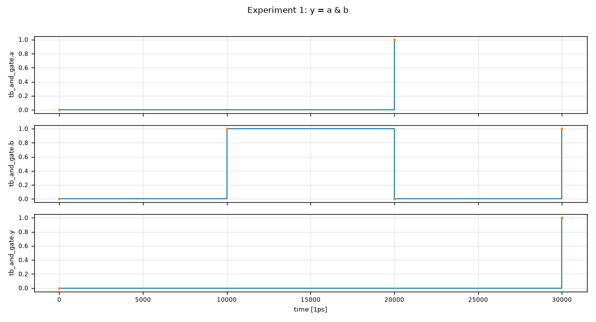

# 实验一　与门电路设计与仿真

> 环境：Robei EDA（Student，Qt 6.8.0）+ Robei 自带 iverilog/vvp（`E:\Robei\bin`）+ robei-mcp
> 工程：`workspace\robei_samples\exp1_and\`　一键复现：`python workspace\robei_samples\exp1_and\exp1_run.py`

## 1　实验目的

1. 学习 Robei 软件的基本操作；
2. 学习用 Verilog HDL 进行设计输入；
3. 初步掌握设计输入、编译、仿真的完整流程。

## 2　实验器材

- Robei EDA 开发软件一套（本机 Student 版）
- 微机一台（Windows）
- robei-mcp（把 Robei 的编译、Verilog 生成、仿真、波形读取封装成工具）

## 3　设计输入

工程 `exp1_and.proj` 下的模型 `model\and_gate.model`：

| 端口 | 方向 | 位宽 | 说明 |
| --- | --- | --- | --- |
| a | input | 1 | 输入 |
| b | input | 1 | 输入 |
| y | output | 1 | 输出 |

`Code` 字段（模型的内部逻辑）：

```verilog
assign y = a & b;
```

写入方式（MCP 调用）：

```
set_robei_port(model, "a", "input")
set_robei_port(model, "b", "input")
set_robei_port(model, "y", "output")
robei_gui_open_project(exp1_and.proj) → robei_gui_open_model("and_gate.model")
robei_gui_code_write("assign y = a & b;")   # SetValue + Ctrl+S
```

## 4　编译

Robei `Build → Compile` 输出：

```
|>Check complete with 0 warnings.
|>Generating C:/dev/robei-mcp/workspace/robei_samples/exp1_and/build/and_gate.v...
|>Compile done.
```

Robei 生成的 Verilog（端口由 `.model` 的 `<Port>` 自动展开）：

```verilog
/*Experiment 1: 2-input AND gate*/

module and_gate(
output wire y,
input wire b,
input wire a
);

  //----Code starts here: integrated by Robei-----
  assign y = a & b;
endmodule    //and_gate
```

## 5　仿真

testbench `test\tb_and_gate.v`：每 10 ns 更换一次输入组合，`$dumpfile/$dumpvars` 记录波形，`$display` 打印结果。

```
t=10000 a=0 b=0 y=0
t=20000 a=0 b=1 y=0
t=30000 a=1 b=0 y=0
t=40000 a=1 b=1 y=1
```

`robei_gui_compile` 与 `simulate` 均返回 `ok: true`，编译 0 warning、仿真 0 error。

## 6　真值表（波形交叉验证）

| a | b | y（实测） | 期望 a&b |
| --- | --- | --- | --- |
| 0 | 0 | 0 | 0 |
| 0 | 1 | 0 | 0 |
| 1 | 0 | 0 | 0 |
| 1 | 1 | 1 | 1 |

`read_waveform` 在 5000 / 15000 / 25000 / 35000 ps 四个稳态时刻采样，逐点判定 `and_ok=True`（4/4）。

## 7　仿真波形



波形说明：`a` 在 30 ns 由 0 变 1，`b` 在 10 ns 变 1、20 ns 变 0、30 ns 再变 1；
`y` 只在 30 ns 之后（a=1 且 b=1）保持高电平——与与门逻辑一致。

## 8　实验结论

1. 与门电路逻辑正确：输出 `y` 仅在 `a=1`、`b=1` 时为 `1`，其余为 `0`；
2. Robei 编译无警告，生成的 `and_gate.v` 与设计输入一致；
3. 从端口定义、逻辑输入、工程编译到仿真与波形读取，全流程由 robei-mcp 工具完成，可脚本复现。

## 9　说明

- 仿真用的是 Robei 自带的 iverilog/vvp（Robei 的 Compile 内部也调用同一套工具链），保证与 GUI 流程一致；
- Robei 在保存模型时会重写端口顺序与坐标（归一化浮点），不影响逻辑与端口方向；
- Robei GUI 里的 `Run`/`Wave` 面板尚未接入 MCP，本实验的波形由 VCD 解析+绘图生成。
